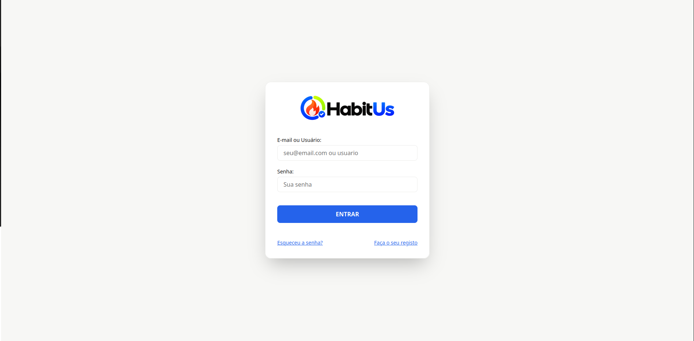
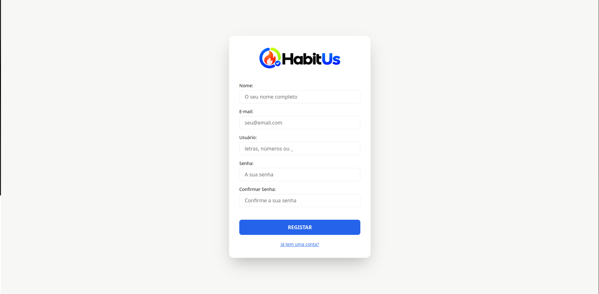
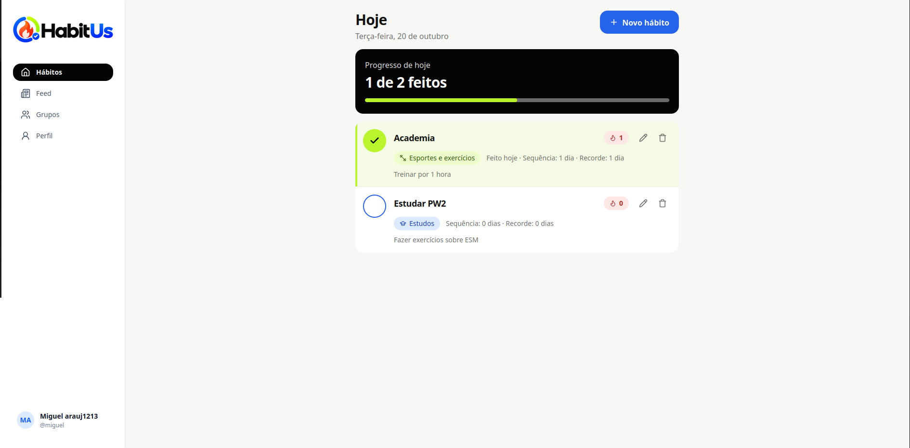
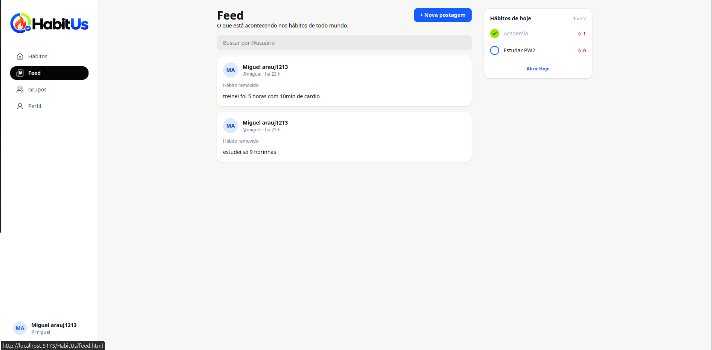
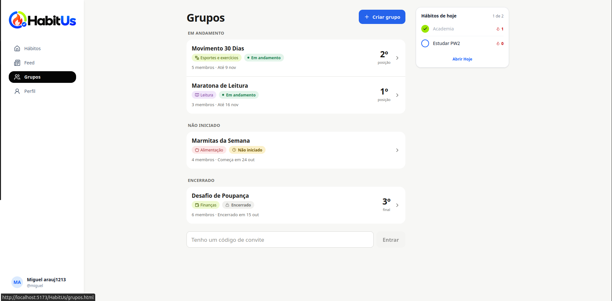
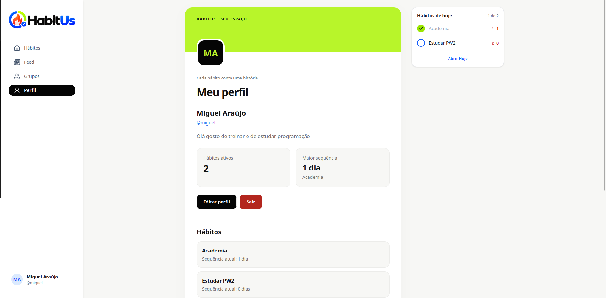

<p align="center">
  
</p>

# HabitUs — Cada hábito conta uma história

Aplicação web para organizar hábitos, acompanhar a constância e compartilhar experiências sobre a rotina.

[Descrição do projeto](#descrição-do-projeto) · [Telas do sistema](#telas-do-sistema) · [Funcionalidades](#descrição-das-funcionalidades-do-projeto) · [Instalação](#instruções-de-instalação) · [Contato](#informações-de-contato)

## Descrição do projeto

O **HabitUs** é um projeto acadêmico de programação web que combina acompanhamento de hábitos pessoais com uma proposta de interação social. O objetivo é ajudar as pessoas a construir rotinas saudáveis e produtivas por meio de registros diários, indicadores de progresso e sequências de dias consecutivos, também chamadas de *streaks*.

O usuário pode cadastrar hábitos, marcar o que realizou no dia, acompanhar seus recordes, personalizar o perfil e publicar relatos no feed. A área de grupos apresenta a proposta de desafios coletivos com atividades, pontuação e ranking, cuja integração ainda está em desenvolvimento.

Nesta primeira entrega, a aplicação funciona no navegador, sem backend. Contas, hábitos, conclusões e postagens são armazenados como JSON no **LocalStorage**. Os dados ficam restritos ao mesmo navegador e à mesma origem do site, sem sincronização entre dispositivos. Limpar os dados do site remove os registros salvos.

### Tecnologias utilizadas

| Tecnologia | Uso no projeto |
| --- | --- |
| HTML5 | Estrutura das páginas e formulários. |
| CSS3 e Tailwind CSS | Estilização e adaptação da interface a diferentes tamanhos de tela. |
| JavaScript com ES modules | Interações, regras de negócio e organização do código. |
| LocalStorage e JSON | Persistência dos dados no navegador. |
| Web Crypto API | Hash de senhas com PBKDF2-SHA256 e salt individual. |
| Vite | Servidor de desenvolvimento e geração da versão de produção. |
| GitHub Actions e GitHub Pages | Automação da publicação e hospedagem estática. |

## Telas do sistema

As capturas abaixo apresentam as principais telas da versão atual. As imagens estão na pasta [`docs/images`](docs/images), com nomes correspondentes às telas.

### Login

Acesso à conta com e-mail ou nome de usuário e senha, além do link para cadastro.



### Cadastro

Criação de conta com nome, e-mail, nome de usuário, senha e confirmação da senha.



### Hábitos — Hoje

Lista dos hábitos do dia, marcação de conclusão, barra de progresso, categoria, descrição, sequência atual e recorde. Também permite criar, editar e excluir hábitos.



### Feed

Exibição de relatos publicados sobre os hábitos, com identificação do autor e acesso à criação de uma postagem. O painel lateral permite acompanhar os hábitos de hoje.



### Grupos

Apresentação dos desafios por situação: em andamento, não iniciado e encerrado. Os cartões mostram categoria, período, quantidade de membros e posição no ranking. **Nesta versão, os grupos e as posições exibidos são demonstrativos.**



### Perfil

Exibição do nome, nome de usuário, descrição pessoal, total de hábitos ativos, maior sequência e lista de hábitos. Inclui as ações de editar o perfil e sair da conta.



## Descrição das funcionalidades do projeto

### Funcionalidades disponíveis

| Funcionalidade | Descrição |
| --- | --- |
| Cadastro e login | Criação de contas, validação dos dados e entrada com e-mail ou nome de usuário. As senhas são armazenadas como hash. |
| Sessão persistente | Mantém a conta conectada após recarregar a página, até o usuário sair. |
| Gestão de hábitos diários | Cadastro com nome, categoria e descrição opcional; edição e exclusão de hábitos. Quando já existe recorde, a edição permite alterar apenas a descrição. |
| Registro de conclusão | Marcação e desmarcação do hábito no dia atual, com no máximo uma conclusão por hábito por dia. |
| Progresso diário | Contagem de hábitos realizados e atualização da barra de progresso. |
| Sequências e recordes | Acompanhamento dos dias consecutivos de conclusão e da maior sequência alcançada. |
| Perfil do usuário | Consulta e edição de nome, nome de usuário e descrição pessoal, com resumo dos hábitos e recordes. |
| Feed de postagens | Criação de relatos em texto associados a um hábito e exibição das postagens salvas no navegador, das mais recentes para as mais antigas. Publicar não marca o hábito como concluído. |
| Painel de hábitos de hoje | Consulta e marcação dos hábitos pelo painel lateral nas telas de feed, grupos e perfil, conforme o espaço disponível. |

### Funcionalidades em desenvolvimento

- **Grupos e desafios:** as telas já apresentam grupos, atividades, ranking e convites, mas a integração dos fluxos com os dados persistidos ainda não está concluída. O formulário de criação de grupo ainda não salva os dados.
- **Outras frequências:** as regras internas contemplam dias específicos e metas de vezes por semana, mas o formulário atual oferece apenas a opção **Todos os dias**.
- **Recuperação de senha e busca por usuário no feed:** os elementos aparecem na interface, mas ainda não possuem o fluxo implementado.
- **Sincronização online:** a segunda entrega prevê React e Supabase para autenticação e persistência compartilhadas. Essas tecnologias ainda não fazem parte da versão atual.

## Instruções de instalação

### Pré-requisitos

- Git.
- Node.js **20.19 ou superior na linha 20**, ou **22.12 ou superior**, com npm.
- Navegador atualizado com JavaScript e LocalStorage habilitados.

### Executar localmente

1. Clone o repositório na branch de desenvolvimento:

   ```bash
   git clone --branch develop https://github.com/MiguelAraujo3/HabitUs.git
   cd HabitUs
   ```

2. Instale as dependências:

   ```bash
   npm install
   ```

3. Inicie o servidor de desenvolvimento:

   ```bash
   npm run dev
   ```

4. Abra o endereço indicado pelo Vite no terminal. Na porta padrão, acesse:

   ```text
   http://localhost:5173/HabitUs/
   ```

5. Na tela de login, escolha **Faça o seu registo**, crie uma conta e cadastre seu primeiro hábito em **Novo hábito**. Os dados mostrados nas capturas não são carregados automaticamente em uma instalação nova.

Não é necessário configurar banco de dados, backend ou variáveis de ambiente para esta entrega. Utilize o servidor do Vite para abrir a aplicação.

### Gerar a versão de produção

```bash
npm run build
```

Os arquivos gerados ficam na pasta `dist/`. Para conferir essa versão localmente:

```bash
npm run preview
```

Abra o endereço informado no terminal, mantendo o caminho `/HabitUs/`.

### Publicação

O projeto está configurado para publicação no GitHub Pages com a base `/HabitUs/`. O workflow em [`.github/workflows/deploy.yml`](.github/workflows/deploy.yml) instala as dependências, gera o build e publica o conteúdo de `dist/` a cada push na branch `develop`.

## Informações de contato

Para dúvidas sobre o projeto, sugestões ou relato de problemas:

- **GitHub de Miguel Araújo:** [@MiguelAraujo3](https://github.com/MiguelAraujo3).
- **Repositório do projeto:** [MiguelAraujo3/HabitUs](https://github.com/MiguelAraujo3/HabitUs).

### Equipe de desenvolvimento

- Miguel Araújo de Oliveira.
- Marcos Antônio de Araújo Moura Neto.
- Jose Manoel Ferreira Silva.
- Gustavo Morais Bastos de Nazare.
- Kauan Machado dos Santos.
